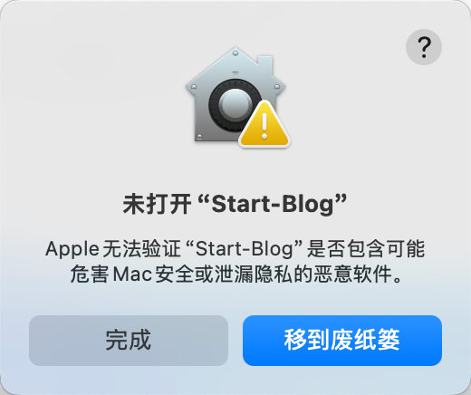
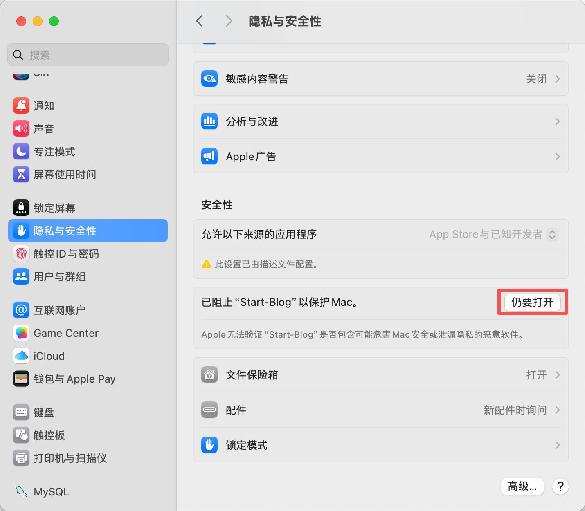

# blog_self · Starry Night Voyage

[中文](README.md) · **English**

A personal blog with Markdown posts, constellation navigation, and an interactive 3D globe for places you have visited. Write on your computer, then publish to GitHub Pages, another static host, or your own server.

[Personal instance](https://sfqin.github.io/blog/) · [Download the client](https://github.com/sfqin/blog_self/releases) · [Report an issue](https://github.com/sfqin/blog_self/issues)

## Choose a workflow

**Where you write and where you host the website are separate choices.** The desktop launcher and local web admin save content to SQLite. Visitors can read an exported static site or a dynamic site running on a server.

| What you need | Writing workflow | Hosting |
| --- | --- | --- |
| No development toolchain | Download the client and write in its browser admin | Publish to GitHub Pages from the admin |
| Latest source or custom design | Compile locally and use the web admin | GitHub Pages or another static host |
| VS Code, Typora, or Obsidian | Write a `.md` file, then paste its body into the admin | Publish using your chosen hosting workflow |
| An existing server with little maintenance | Write locally and export static files | Nginx or another static file server |
| Edit online and publish changes immediately | Use the personal instance with daemon mode and an authenticated management gateway | Go + Nginx + systemd; see [dynamic hosting](#dynamic-hosting-personal-instance) |

> **There is currently no Markdown directory scanner or bulk file importer.** Dropping a `.md` file into the repository does not create a post. The supported workflows and actual storage locations are described below.

## Writing option 1: desktop client

The client starts a local blog service and opens its admin in your browser. It uses the same editor as the source build, without requiring Go or terminal commands.

Download and extract the complete archive from [GitHub Releases](https://github.com/sfqin/blog_self/releases):

| System | Archive | Launcher |
| --- | --- | --- |
| macOS, Apple Silicon / Intel | `Blog-macOS.zip` | `Start-Blog.app`; fallback: `Start-Blog.command` |
| Windows x64 | `Blog-Windows.zip` | `Start-Blog.exe`; troubleshooting: `Start-Blog-console.bat` |

**Version note: this README describes master. The published v1.2.0 packages predate the Starry Night Voyage redesign. To use the new design now, run from source or [build the client packages](#development-and-packaging). Updating master does not automatically update GitHub Releases.**

1. Launch the client and open `/setup`. If you plan to publish to GitHub, follow the prompts to install Git / GitHub CLI and authorize GitHub in your browser.
2. Create your own repository or connect one you can publish to. The wizard creates public repositories for GitHub Pages.
3. Open `/admin`, fill in your profile and other sections, and create a post under Posts.
4. Enter a title, slug, date, tags, and Markdown body. Leave `published` unchecked for a draft; check it when the post is ready for readers.
5. Preview the local homepage, then publish from `/admin/publish` or `/setup`. Wait for GitHub Pages to finish building before opening the public URL.

Writing and previewing locally do not require a GitHub account. GitHub authorization is for repository creation and publishing, not authentication to the local admin.

<details>
<summary>First launch blocked by macOS or Windows</summary>

On macOS, verify the download source, then use **System Settings → Privacy & Security → Open Anyway** and launch again.




On Windows, after verifying the source, choose **More info → Run anyway** in SmartScreen.

</details>

Client data lives in `dev-home-blog/blog.db` under your user home directory, outside the application package. After replacing the client package, restart it to keep using that data. In the current source, local mode exits roughly five minutes after all blog pages stop sending heartbeats; launch it again when needed.

## Writing option 2: run the web admin locally

Use this for the latest master, Linux, or code changes. You need **Go 1.23+**, Git to clone the source, and GitHub CLI (`gh`) for Pages publishing. Normal operation does not need Node.js, MySQL, or a separate frontend build service.

### macOS / Linux

```bash
git clone https://github.com/sfqin/blog_self.git
cd blog_self
go build -o ./blogbin .

DATA_DIR="$HOME/dev-home-blog"
mkdir -p "$DATA_DIR"
ADDR=127.0.0.1:8080 \
  DB_PATH="$DATA_DIR/blog.db" \
  REPO_DIR="$DATA_DIR" \
  ./blogbin serve
```

Keep the terminal running and open:

| URL | Purpose |
| --- | --- |
| `http://localhost:8080/` | Preview the site |
| `http://localhost:8080/admin` | Edit all content |
| `http://localhost:8080/setup` | Set up GitHub and publish |
| `http://localhost:8080/admin/publish` | Publish subsequent updates |

If port 8080 is occupied, the service tries subsequent ports. Use the address printed in its startup log.

The explicit `DB_PATH` reuses the client's data. `REPO_DIR` points to your own publishing workspace so that the upstream source repository is not mistaken for your publishing target. Avoid editing the same database through two running instances.

<details>
<summary>Windows PowerShell</summary>

```powershell
git clone https://github.com/sfqin/blog_self.git
cd blog_self
go build -o blogbin.exe .

$dataDir = Join-Path $env:USERPROFILE "dev-home-blog"
New-Item -ItemType Directory -Force $dataDir | Out-Null
$env:ADDR = "127.0.0.1:8080"
$env:DB_PATH = Join-Path $dataDir "blog.db"
$env:REPO_DIR = $dataDir
.\blogbin.exe serve
```

</details>

The local admin has no account or password. These commands bind it to loopback. Online editing requires an authenticated management entry point; do not expose the local `/admin` or `/setup` directly to the internet.

## Writing option 3: use your Markdown editor

Write in VS Code, Typora, Obsidian, or another editor. For example, you can create:

```text
~/my-writing/
└── my-first-post.md
```

This is your own folder, **not an import path recognized by the application**.

1. Finish the Markdown body in your editor.
2. Open **Admin → Posts → New** and paste it into the Markdown body field.
3. Enter the title, slug, date, and tags separately. The application does not extract these fields from filenames or YAML front matter.
4. Preview, mark the post `published`, and save. For static hosting, publish the site again.

For a post titled “My first post” with slug `my-first-post`, the body could be:

```markdown
## Starting a record

Write paragraphs, **highlights**, lists, quotations, and code blocks here.


```

The dynamic route is `/posts/my-first-post`; the exported file is `posts/my-first-post.html`. Templates generate the appropriate static links.

Headings, lists, fenced code, blockquotes, and tables are supported. Images and videos use external URLs: upload them to your own image host or object storage first. The application has no built-in image/video upload storage.

### Why not put posts in `posts/` or `web/`?

| Location | Actual purpose |
| --- | --- |
| `posts` table in `blog.db` | Source of post data; the `body_md` field stores Markdown |
| `web/templates/public/post.html` | Shared page template, not a post |
| `web/static/` | Application styles, scripts, fonts, and map data |
| `posts/*.html` in the export directory | Generated output, replaced on the next export |
| A custom `.md` directory | Your writing materials; not automatically read by the application |

Maintain posts through the admin. Editing generated HTML will not update the source content, and direct SQL changes are unnecessary for ordinary writing.

## Hosting option 1: GitHub Pages

**Recommended for writing locally and sharing a public site.** Pages serves exported HTML, CSS, JavaScript, maps, and public content. It does not run Go or provide a writing backend.

1. Start the client or local source build.
2. Authorize GitHub in `/setup` and confirm that the target repository is yours.
3. Click Publish after editing. The application exports public content from the active database and pushes it to `gh-pages`.
4. If Pages was not enabled automatically, open **Settings → Pages → Deploy from a branch → gh-pages → /(root)**.
5. Wait for the Pages build and visit `https://your-username.github.io/repository-name/`.

The daily workflow is **edit → save → preview → publish again**. Checking `published` marks a post as public; it does not itself update GitHub Pages. Drafts are excluded from the export.

`master` contains source code; `gh-pages` contains the generated website. Updating one does not automatically update the other. The database is not uploaded to Pages. The wizard uses the repository name as the URL prefix; an ordinary project repository such as `blog` is recommended.

### Export commands and publishing scripts

To generate files without pushing them, run from the directory containing the built `blogbin`:

```bash
# /blog must match the target repository name.
DB_PATH="$HOME/dev-home-blog/blog.db" BASE_URL=/blog \
  ./blogbin export "$HOME/blog-export"
```

`export` clears and rebuilds its output directory. Use a dedicated generated-output folder, not a database or writing directory.

Check the repository and remotes before using the advanced scripts:

| Entry point | Behavior in the blog_self upstream |
| --- | --- |
| `scripts/publish.sh` | Builds root-path `dist/`, commits it, and pushes the current source branch |
| `scripts/publish-all.sh` | Updates and pushes `dist/`, then publishes `gh-pages`; may also push to a configured Gitee remote |
| Admin Publish button | Pushes the static site to the target `gh-pages` branch without committing source changes |

`SKIP_GITEE=1` skips Gitee in the upstream multi-host script; `SUBPATH=/repository-name` controls the URL prefix. **Prefer the admin button if you only need GitHub Pages.** The personal instance's similarly named script behaves differently: it does not commit `dist/` to master. Follow that repository's documentation.

## Hosting option 2: another static host or your own Nginx

Use this with Cloudflare Pages, EdgeOne Pages, a domain, or an existing server. The public server does not need Go or SQLite.

### Export for a domain root

```bash
DB_PATH="$HOME/dev-home-blog/blog.db" BASE_URL= \
  ./blogbin export "$HOME/blog-export"
```

```text
blog-export/
├── index.html
├── posts/               # Published post HTML
├── api/footprints       # Footprint data
├── api/search           # Public search index
└── static/              # Styles, scripts, fonts, maps
```

Use an empty `BASE_URL` for `https://example.com/`, or `/blog` for `https://example.com/blog/`. An incorrect prefix breaks asset and post URLs.

- **Cloudflare Pages / EdgeOne Pages:** upload the generated output, or configure the platform to deploy static artifacts committed to your own publishing repository. These files are already built locally; no Go or npm build is required on the host.
- **Nginx:** upload to a dedicated document root. For an existing `/var/www/my-blog/` with the appropriate write permissions:

```bash
rsync -av --delete "$HOME/blog-export/" blog@your-server:/var/www/my-blog/
```

`--delete` removes withdrawn posts from the destination. That destination must contain only this generated site, not a database or another application's files.

Example Nginx routing; configure your own domain and TLS certificates separately:

```nginx
server {
    listen 80;
    server_name blog.example.com;
    root /var/www/my-blog;
    index index.html;

    location / {
        try_files $uri $uri.html $uri/ =404;
    }
}
```

Export and upload again after each content change. **Do not place `blog.db` in the public document root.**

## Dynamic hosting: personal instance

A dynamic site reads SQLite on the server. Changes saved through its server admin appear on the public site on the next page load, without a static export. GitHub Pages does not update automatically from those changes. The author's online admin depends on a separate private Ops platform that is not distributed with this project; other deployments can use static publishing or integrate their own authenticated gateway.

The two repositories currently differ:

| Repository | Role | Dynamic runtime |
| --- | --- | --- |
| [blog_self](https://github.com/sfqin/blog_self) | Open-source upstream template | Local mode exits after roughly five minutes without heartbeats; it does not currently read `SERVER_MODE` |
| [blog](https://github.com/sfqin/blog), local directory `s_blog` | Author's personal instance | Supports persistent `SERVER_MODE=1` operation and an authenticated Ops management gateway |

**For the upstream template on your own server, prefer static hosting above.** The bundled `Caddyfile`, `s_blog.service`, and `scripts/deploy.sh` are earlier references. They do not include the personal instance's current daemon and management gateway configuration.

For that instance, see the [self-hosting and writing guide](https://github.com/sfqin/blog/blob/master/docs/self-hosted.md) for build/upload steps, systemd configuration, management entry points, data paths, updates, and rollback. It includes the author's site configuration; replace it with your own when reusing the instance.

## Data locations and backups

| How you start the application | Content database |
| --- | --- |
| macOS client | `/Users/your-name/dev-home-blog/blog.db` |
| Windows client | `C:\Users\your-name\dev-home-blog\blog.db` |
| Source commands in this README | Same as the client, through the explicit `DB_PATH` |
| `./blogbin serve` without `DB_PATH` | `blog.db` in the working directory |
| Personal instance's server | `/opt/s_blog/data/blog.db`; verify the actual service configuration |

Client, repository-local, and server databases **do not synchronize automatically**. If content differs, check the running process's `DB_PATH`. An exported static site is not a complete database backup.

After stopping the service, you can back up the entire data directory. While it is running, use SQLite's online backup instead of copying only a database that may have pending WAL writes. With the `sqlite3` command installed:

```bash
BACKUP_FILE="$HOME/blog-backup-$(date +%Y%m%d-%H%M%S).db"
sqlite3 "file:$HOME/dev-home-blog/blog.db?mode=ro" ".backup '$BACKUP_FILE'"
```

To move to another computer, stop the destination process, place the backup at its `DB_PATH`, and restart. Maintain external images/videos separately. Do not commit the database to GitHub.

## Configuration and development

| Variable | Default | Purpose |
| --- | --- | --- |
| `ADDR` | `:8080` | Bind address; explicitly use `127.0.0.1:8080` for local use |
| `DB_PATH` | `blog.db` | SQLite database path |
| `REPO_DIR` | `.` | Publishing workspace used by the GitHub wizard |
| `BASE_URL` | Empty | Static export URL prefix, such as `/blog` |
| `SECURE_COOKIES` | Off | Set to `1` for HTTPS-only CSRF cookies; leave off for local HTTP |

### Development and packaging

Templates, CSS, JavaScript, fonts, and maps are embedded in one executable with `go:embed`. **Content edits need a save; UI/code changes require a rebuild and restart. Static hosts also need a new export and deployment.**

```bash
go build -o ./blogbin .
go test ./...
go vet ./...
npm ci --prefix scripts       # Node.js is only for browser tests/map tooling
npm test --prefix scripts

# Build client archives on macOS/Linux; recreates dist-release/.
./scripts/package-release.sh
```

The archives are `dist-release/Blog-macOS.zip` and `dist-release/Blog-Windows.zip`. A maintainer must upload them to GitHub Releases separately. Launcher sources live in `packaging/`, `cmd/windows-launcher/`, and the root startup scripts.

| Path | Purpose |
| --- | --- |
| `main.go` | `serve` / `export` entry points |
| `internal/store/` | SQLite schema and content access |
| `internal/server/` | Public, admin, and wizard routes |
| `internal/export/` | Static site generation |
| `internal/setup/` | GitHub authorization, repositories, publishing |
| `web/templates/` | Public and admin templates |
| `web/static/` | Styles, interactions, fonts, maps |
| `scripts/seed_fixture.sh` | Fictional fixtures; replaces target database content, for test databases only |

## Design and interactions

- Seven entry points: profile, experience, footprints, posts, projects, thoughts, moments. Empty content sections are hidden and remain dim stars in navigation.
- Constellation navigation docks on scroll; mobile uses a bottom star rail.
- The globe supports rotation, zoom, click selection, double-click drill-down, and routes from your home location. Regional data covers China, Japan, Malaysia, Singapore, and Thailand.
- Posts have remembered night/paper reading modes, a table of contents, and reading progress.
- Fonts are self-hosted, motion respects reduced-motion preferences, and the admin retains its terminal style.

Noto Serif SC and Bodoni Moda use the SIL Open Font License 1.1. Keep the license and copyright notices in [OFL.txt](web/static/fonts/OFL.txt) when redistributing them.
